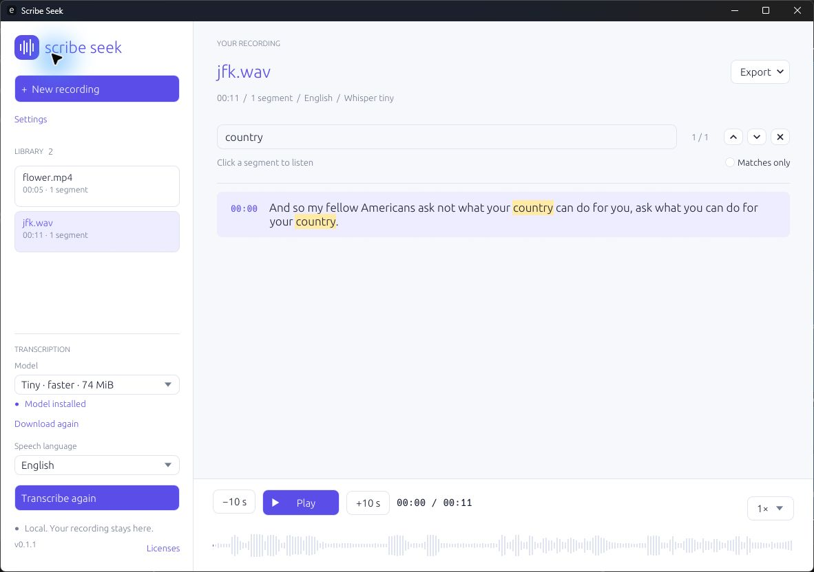
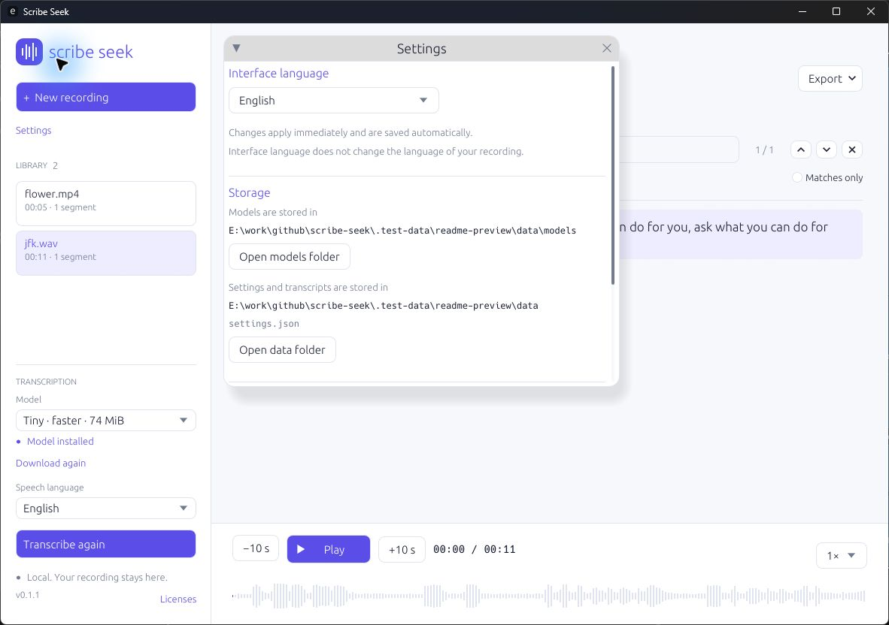

# Scribe Seek

A native Rust desktop app that turns long audio or video recordings into searchable
transcripts. Drop a file, find a phrase, and click a segment to play from its timestamp.
Speech recognition runs locally with Whisper / whisper.cpp.

**[Download ScribeSeek-v0.1.2.exe](https://github.com/siarheisinelnikau/scribe-seek/releases/download/v0.1.2/ScribeSeek-v0.1.2.exe)**
· [Portable ZIP](https://github.com/siarheisinelnikau/scribe-seek/releases/download/v0.1.2/ScribeSeek-v0.1.2.zip)
· [All releases](https://github.com/siarheisinelnikau/scribe-seek/releases)

Windows 10/11 x64. No installer, Python or FFmpeg required.

Screenshots show v0.1.1. Version 0.1.2 keeps this layout and replaces the Windows
renderer and application icon.



## Quick start

1. Download the standalone Windows EXE from [Releases](https://github.com/siarheisinelnikau/scribe-seek/releases/latest).
2. Run `ScribeSeek-v0.1.2.exe`.
3. Choose a model and select **Download model**. Tiny is useful for a quick trial;
   Small generally provides better recognition. Downloads are verified by size and SHA-256.
4. Drop a recording into the window or select **New recording**.
5. Choose **Speech language** or **Detect automatically**, then select **Transcribe recording**.
6. Search the transcript and click a segment to listen from its timestamp.

Recordings and transcripts stay on your computer. Recognition works offline after
the model has been downloaded. The app does not upload recordings or collect telemetry.
Internet access is used for model downloads and optional GitHub update checks.
Transcripts are saved in the local library; playback needs the original media file.

The interface defaults to English. **Settings → Interface language** offers English,
Russian, French, German, Spanish and Italian. Language changes apply immediately and
persist between sessions, independently of the speech recognition language.
Russian interface text is confined to localization resources. Project documentation,
source comments, internal messages and release notes are written in English.

The speech language selector supports searching by localized name, English name or
language code. Ukrainian and Belarusian are excluded from the product's language list.
The bundled Tiny/Base/Small options support the remaining 97 engine languages;
Cantonese is listed as unavailable because it requires a Whisper v3 model.

## Features

- File import and drag-and-drop, including Unicode file paths.
- WAV, MP3, FLAC, AAC, M4A, AIFF, Ogg Vorbis and Ogg Opus audio, including `.opus` voice messages.
- Audio tracks from MP4/MOV/MKV files when their audio codec is supported, such as AAC-LC.
- Multilingual Tiny (74 MiB), Base (141 MiB) and Small Q5 (181 MiB) models.
- Background recognition with progress reporting and cancellation.
- Case-insensitive transcript search, highlighted matches and a matches-only filter.
- Timestamp playback, waveform seeking, ten-second skips and 0.75–2× playback speed.
- TXT, SRT, VTT and JSON export.
- A persistent local library with atomic JSON writes.
- In-app update checks, verified downloads and restart-to-update support.

Shortcuts: `Ctrl+O` opens a file, `Ctrl+F` focuses search, `Enter` / `Shift+Enter`
select the next / previous match in search, and `Space` toggles playback outside text fields.

## One executable

Windows x64 is the primary platform. The UI, decoders, player and Whisper engine
are statically linked into one executable. Running it requires no Python, Node.js,
FFmpeg, WebView or separate VC++ Runtime installation.

Requirements: Windows 10/11 x64 and a CPU supporting AVX2, FMA and F16C
(Intel Haswell / AMD Ryzen or newer).

Model weights are separate, one-time downloads of 74–181 MiB. A fully offline copy
consists of the executable and a previously downloaded model.

The Windows interface uses egui with CPU rasterization and Win32 GDI presentation.
It does not create an OpenGL context. Idle windows wait for events, unchanged scenes
skip rendering, and uncovered windows reuse a retained bitmap. DPI changes rebuild
the pixel-sized render target and font textures at the new scale.

## Storage and portable mode

The default data directory is `%LOCALAPPDATA%\ScribeSeek`:

```text
ScribeSeek/
  settings.json # Interface language, speech language and selected model
  models/       # Downloaded Whisper models
  transcripts/  # Text, timestamps and original media paths
```

**Settings → Storage** displays the model and data directories.
**Open models folder** opens the model directory; **Open data folder** opens the
directory containing `settings.json` and saved transcripts.

For portable mode, place an empty file named `portable` beside the executable.
The app will store its data in `scribe-seek-data` beside it. You can also set
`SCRIBE_SEEK_DATA_DIR` to choose a data directory explicitly.
Library files are ordinary, unencrypted JSON. Original recordings are not copied.



## In-app updates

Open **Settings → Updates → Check for updates**. Automatic startup checks are
enabled by default and can be disabled in the same section. Update checks use only
stable releases from this repository and require no GitHub account or token.

Select **Download update**, then **Restart and update**. The app closes, replaces
the executable with the verified download, and restarts using the same data directory.
Restarting is unavailable while recognition or a model download is running.

The shared `rust-auto-updator` engine checks the version, repository URL, size,
SHA-256 and Windows PE architecture. It uses `SHA256SUMS.txt` when supplied and
the GitHub asset digest for older releases; both must agree when supplied.
The checksum verifies integrity relative to GitHub; independent digital signatures
are not yet provided. A backup is retained in a validated `.scribe-seek-update-…`
staging folder until successful restart cleanup; installation or launch failure
restores it. An unwritable application directory produces an error. The verified
download runs the helper protocol. Settings, transcripts and models stay intact.

## Build

Install Rust stable ≥1.95, Visual Studio Build Tools with C++ and the Windows SDK,
CMake, and libclang (LLVM). These tools are needed only for development.
Use a CMake version compatible with your Visual Studio installation.
Keep the `rust-auto-updator` workspace beside this repository. It is an explicit
local path dependency; CI/source builds must provision that workspace separately.
No registry package or remote checkout location is assumed.

```powershell
# If LLVM is installed separately:
$env:LIBCLANG_PATH = 'C:\Program Files\LLVM\bin'
. ./scripts/build-env.ps1
cargo build --release --locked
./target/release/scribe-seek.exe
```

The setup script selects Visual Studio's bundled CMake unless `CMAKE` is already set.
Alternatively, download just the build-time libclang library into the project:

```powershell
python -m pip install --target .test-data/tooling libclang==18.1.1
. ./scripts/build-env.ps1
cargo build --release --locked
```

The script finds this local DLL automatically. Python is not included in the executable.
Do not set `WHISPER_DONT_GENERATE_BINDINGS`: the crate's bundled bindings are unsuitable
for Windows, so bindings must be generated with libclang during the build.

## Validation and releases

```powershell
cargo fmt --all -- --check
python scripts/check_locales.py
. ./scripts/build-env.ps1
cargo clippy --locked --all-targets -- -D warnings
cargo test --locked
```

A command-line example downloads a missing model, transcribes a file, saves the
result in the library and prints SRT:

```powershell
. ./scripts/build-env.ps1
cargo run --release --locked --example transcribe -- recording.wav .test-data/data tiny en
```

Optional tests with a real audio device and Whisper:
`cargo test --locked --test local_pipeline -- --ignored --test-threads=1`.
The Whisper test needs `.test-data/jfk.wav` from whisper.cpp's public samples and
the Tiny model in `.test-data/data/models/`.

GitHub Actions checks formatting, translations, Clippy and tests, builds the Windows
EXE, verifies the native update helper, and uploads EXE/ZIP/SHA-256 artifacts.
To publish a version, update `Cargo.toml` and `Cargo.lock`, write reviewed English
release notes in `releases/v<version>.md`, update the README download links, and push to `main`.
After successful validation, the workflow creates `v<version>` and publishes the release.
A manually pushed version tag must also match Cargo. Assets are uploaded to a draft,
their SHA-256 digests are checked, and only then is the release published.
Published versions remain unchanged; subsequent releases require a version bump.
Other branches and pull requests only run validation.
An explicitly authorized release repair can use a `Replace-Release-Commit: <SHA>`
commit trailer. It must match the existing release commit; the workflow hides the
release, moves its tag and verifies replacement assets before publishing it again.
A `Repair-Release-Tag: v<version>` commit trailer restores a detached release tag
through a dedicated workflow job. The existing tag must match the release commit;
verified assets are preserved.
A `Refresh-Release-Assets: v<version>` trailer explicitly refreshes download names,
release notes and the documentation archive of an existing release. Its published
executable bytes and version tag are preserved.

Standalone downloads use **`ScribeSeek-v<version>.exe`**, with no architecture suffix
while Windows x64 is the only executable architecture. The documentation archive is
**`ScribeSeek-v<version>.zip`** and includes the README screenshots and license notices.
`SHA256SUMS.txt` names the versioned EXE; each GitHub asset also has a SHA-256 digest.

The updater prefers the versioned executable and accepts the legacy name for older
releases. An identical **`scribe-seek-windows-x64.exe`** compatibility copy remains
available so already installed 0.1.x versions can still update. It is the same x64
build, not another architecture variant. Use the versioned download for new installations.
Run `./scripts/test_update.ps1` to verify replacement, restart and rollback backup
with isolated test executables. Run `cargo run --release --locked --example check_updates`
to check the release API without opening the UI.

Tests cover transcript search, audio, localization, speech languages, settings,
storage, verified updates and layout. Layout checks cover 108 combinations of UI
language, window size, selected model and model availability. Only the recording
library scrolls; import, settings and recognition controls remain accessible.
Manual checks include MP4/AAC import, Tiny download verification, actual recognition
and audio playback. `dumpbin /dependents` reports only Windows system DLLs.

Test media: [whisper.cpp JFK sample](https://github.com/ggml-org/whisper.cpp/blob/master/samples/jfk.wav)
and [MDN flower video](https://interactive-examples.mdn.mozilla.net/media/cc0-videos/flower.mp4).

## Renderer diagnostics

For a finite renderer diagnostic without external input or desktop capture, set
`SCRIBE_SEEK_RENDER_DIAGNOSTIC` to an absolute JSON output path. Launch the release
EXE with `--data-dir PATH` pointing to an isolated data folder whose `settings.json`
contains `{"check_updates_on_startup":false}`. The app samples visible idle, hides
its own window, restores it and exits after 18 seconds. Counts cover actual layout,
CPU raster and GDI present calls; CPU is reported as a percentage of one logical
core. Hidden/minimized windows keep worker results queued without building scenes.
The diagnostic does not test user input latency or physical audio output.

`scripts/inspect-icons.ps1 -Executable PATH` loads and renders the packaged icon
resources at native sizes without launching the target. Scribe Seek is a regular
windowed application and intentionally has no tray icon.

## Current limitations

- Video files play their audio track; video frames are not displayed.
- WMA, AC-3, WebM/Opus, multichannel Ogg Opus and chained Ogg Opus are unsupported.
  A supported container extension does not guarantee that its audio codec is supported.
- Decoded recordings are held in RAM as mono 16 kHz audio: roughly 154 MB for
  forty minutes, plus model memory. Recordings are limited to four hours.
- Timestamps follow Whisper segments. Speaker diarization and transcript editing are not available.
- Playback speed changes voice pitch. Recognition speed depends on the CPU.
- Tiny has limited accuracy; noise, music and silence can produce recognition errors.
- Changing the source path, size or modification time requires reopening the recording.
  The size/time fingerprint is not a cryptographic content check.
- Linux and macOS builds have not been validated.

## Architecture and licenses

`app` contains the egui UI; `desktop` hosts the reactive Windows CPU/GDI renderer;
`worker` runs background jobs; `audio` combines
Symphonia, static libopus and Rubato resampling; `transcribe` integrates Whisper;
`playback` uses Rodio; `transcript` handles search and subtitles; `storage` manages
the library; `model` verifies model downloads; `updater` manages GitHub updates.
`Cargo.lock` pins dependencies, and `GGML_NATIVE=OFF` avoids tuning the distributed
executable to the build machine's CPU.

Application code is [MIT licensed](LICENSE). [Buzz](https://github.com/chidiwilliams/buzz)
is a product reference; its code has not been copied. Recognition uses
[whisper-rs](https://github.com/tazz4843/whisper-rs) /
[whisper.cpp](https://github.com/ggml-org/whisper.cpp), with models from
[ggerganov/whisper.cpp](https://huggingface.co/ggerganov/whisper.cpp).
Audio decoding uses [Symphonia](https://github.com/pdeljanov/Symphonia) (MPL-2.0)
and [libopus](https://opus-codec.org/) (BSD).

Dependency notices are in `THIRD_PARTY_LICENSES.txt` and embedded in the executable.
Regenerate them with `python scripts/generate_licenses.py` after `cargo fetch`.
Localized language names come from Unicode CLDR and are embedded in the app;
see `locales/UNICODE_LICENSE.txt`. Update them with `python scripts/update_language_names.py`.
UI translations live in `locales/{en,ru,fr,de,es,it}.json`.

For local Windows rendering diagnostics, set `SCRIBE_SEEK_RENDER_TRACE` to a JSONL
file path before launch. It records layout/raster/presentation timings, presented
frames, skipped unchanged scenes and retained-bitmap restores. Press `F12` to record
counters without triggering a paint. With the variable unset, tracing is disabled.
Window and EXE icons are built from `assets/app.svg`; regenerate their checked-in
native assets with `python scripts/generate_icon.py` (requires Pillow).
